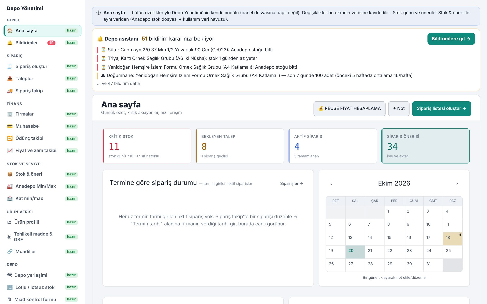
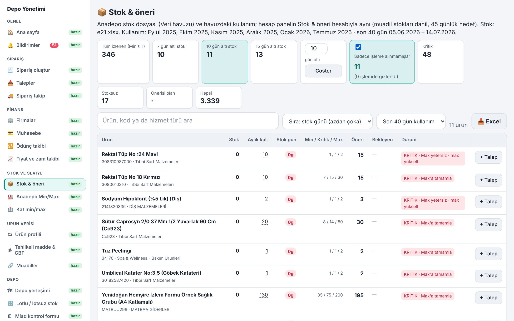
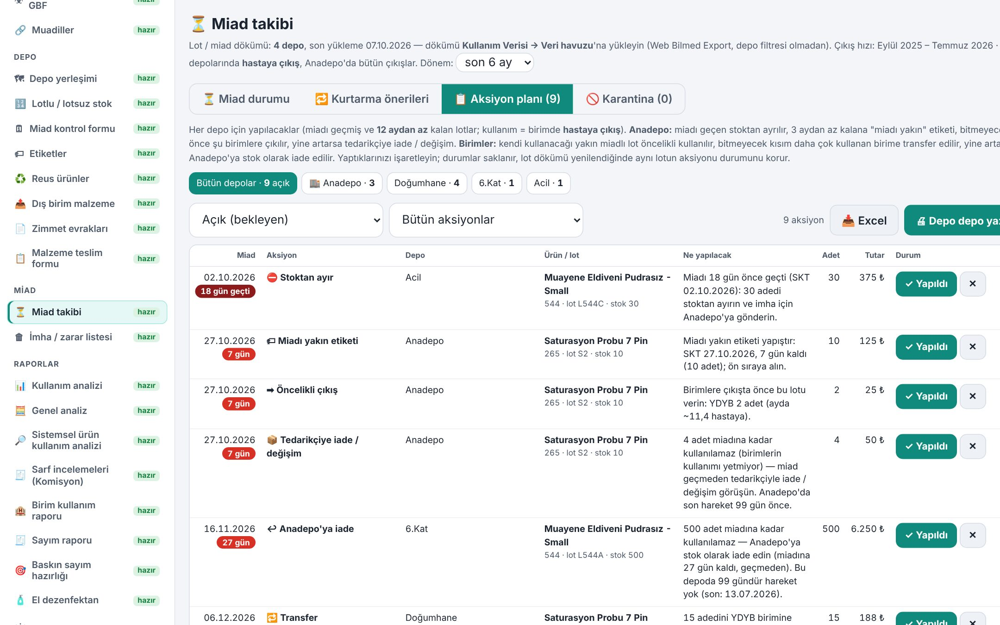
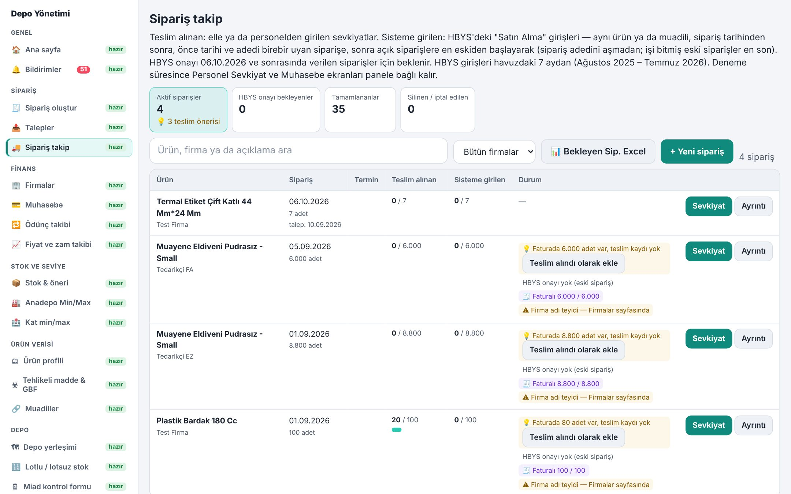

# Depo Yönetim Sistemi — Proje Tanıtımı

Hastane deposu için uçtan uca **stok, sipariş, miad ve birim seviye yönetimi**. Hastane bilgi yönetim sisteminin (HBYS) karşılamadığı depo süreçleri için geliştirdiğim; depo, satın alma, muhasebe, saha personeli ve hastane birimlerinin ortak kullandığı web tabanlı sistem. Bir özel hastanede, hastanenin kendi sunucusunda günlük olarak kullanılıyor.

**▶ Tanıtım sayfası ve video:** https://osmanklync.github.io/depo-yonetim-tanitim/

> Bu depo yalnızca tanıtım içindir: ekran görüntüleri ve kısa bir video. **Kaynak kod paylaşılmamaktadır.** Görüntüler anonimleştirilmiş örnek verilerle hazırlanmıştır; kurum, tedarikçi ve kişi adları gerçek değildir.

## Neler yapıyor

| | |
|---|---|
| **Stok & öneri** | Muadil stokları dahil stok günü, 45 günlük hedefe göre sipariş önerisi; seçilen gün sınırının altına düşen ve henüz talep/sipariş açılmamış ürünler; Excel çıktısı |
| **Sipariş takip** | Talep → sipariş → teslim → HBYS girişi → fatura zinciri; personel sevkiyatlarının otomatik işlenmesi; etiket basma |
| **Birim min–kritik–max** | Gerçek kullanıma dayalı seviye önerisi, HBYS aktarım dosyası; birimlerin şifresiz ekrandan gerekçeli revizesi |
| **Miad yönetimi** | Lot bazında miad grupları, birimler arası kurtarma önerileri, aksiyon planı, karantina; lotsuz ürünler için kalite formatında kontrol formu |
| **Analizler** | Sistemsel ürün kullanım analizi (birime giren / hastaya çıkan), genel analiz, baskın sayım önerileri |
| **Roller** | Depo sorumlusu, saha personeli, birimler, satın alma, muhasebe, yönetim — her rol yalnız kendi ekranlarını görür |

## Teknik özet

Node.js sunucu · tarayıcı tabanlı arayüz (bilgisayar, tablet, telefon) · SQLite · HTTPS · rol bazlı yetkilendirme ve işlem kaydı · otomatik yedekleme · Excel/Word çıktıları · hasta kimlik bilgisi saklanmaz.

---

**Osman Kalyoncu** · Depo ve Operasyon Yöneticisi · [LinkedIn](https://www.linkedin.com/in/osmankalyoncu/)
